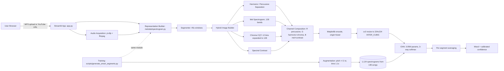

# Architecture: MelodAI Music Mood Classifier

**Author**: Kavya Aggarwal

This document details the engineering architecture of MelodAI: how audio becomes a three-channel image, how that image becomes a mood, where the training and serving paths meet, and what the reported numbers do and do not mean.

---

## 1. High-Level System Blueprint

---

## 2. Layered Software Architecture

### Presentation Layer (`app.py`)
Streamlit single-page application. Accepts an MP3/WAV upload or a YouTube URL, renders the exact three-channel image the network receives, and reports the predicted mood with its probability distribution. The preview is the model's literal input, not a decorative spectrogram, so a preprocessing fault is visible rather than silent.

### Representation Layer (`melodai/spectrogram.py`)
The single source of truth for turning audio into model input, imported by both the app and the training scripts. Exposes `hybrid_image`, `to_model_input`, `segments` and `predict`. This module exists because its absence was a defect: training and serving each built their own representation and silently diverged (see §4).

### Model Layer (`models/best_model.h5`)
Custom CNN, 3,053,699 parameters, input `(224, 224, 3)`, output a 3-way softmax over `[Emotional, Energetic, Peaceful]`. Trained with label smoothing, early stopping on validation accuracy, `ReduceLROnPlateau`, and `ModelCheckpoint` on best validation accuracy.

### Data Preparation Layer (`scripts/`)
`download_songs.py` fetches 90-second clips; `generate_smart_segments.py` cuts two 45-second segments per song and emits four augmented variants of each; `resizing.py` normalises every image to 224x224; `train_segmented_model.py` trains; `evaluate_song_level.py` evaluates (see §4).

---

## 3. The Representation, in Detail

The central design decision is that a CNN is given three *different* views of the same audio rather than one view copied three times. Each channel is percentile-normalised between the 2nd and 98th percentile, so a single loud frame cannot flatten the rest of the image.

| Channel | Content | What it carries |
|---|---|---|
| Red | Percussive component after HPSS | Rhythm and attack density |
| Green | `0.5 x` harmonic mel `+ 0.5 x` chroma expanded to 128 rows | Melody and key content |
| Blue | `0.6 x` mel `+ 0.4 x` spectral contrast | Overall energy and timbral texture |

Fixed parameters: `sr=22050`, `n_mels=128`, `hop_length=256`, `n_fft=2048`, `fmin=20`, `fmax=8000`, Gaussian blur `sigma=0.5` per channel.

The image is then written to PNG through matplotlib with `origin="lower"` and resized by OpenCV. That file round trip is part of the representation, not an implementation detail: it flips the image vertically and quantises it to 8 bits, and the model learned on the result. Reproducing it in memory would produce a different distribution.

---

## 4. Verification and Known Limits

### The defect this architecture is built to prevent
Training produced the three-channel image described above. The deployed app independently produced a plain mel spectrogram at `hop_length=512`, stacked it into three identical greyscale channels, and zero-padded the 128-row result into a 224x224 frame, leaving **43% of the image black** on a 45-second clip and 90% on a short one. The training script selects cross-channel features by name; all of them are identically zero when the channels are copies.

Nothing raised. The app returned a confident-looking percentage while the probability vector sat near a third each, which is what guessing looks like. `tests/test_spectrogram.py` now asserts bit-identical equality (`np.array_equal`) between this module and the training script's own function, and fails if either drifts.

### Measured, on a clean song-grouped holdout

Reproducing the original evaluation gives **66.1% per image**, matching the
reported figure exactly, and **62.1% per song**. Rebuilding the split so that
songs are grouped and contradictory labels removed, and scoring both models
on that identical 25-song holdout:

| | overall | emotional | energetic | peaceful |
|---|---|---|---|---|
| original model | 64.0% | 100% | 100% | **0%** |
| retrained (`train_v2.py`) | 64.0% | 45% | 100% | **67%** |

The same headline number describes two very different systems. The original
model never once predicts `peaceful` correctly on this holdout; it scores
64% because the other two classes account for 16 of the 25 songs. It is a
two-class classifier reported as a three-class one, and a single accuracy
figure conceals that completely.

The retrained model discriminates all three classes. It is not yet a better
classifier by the headline metric; it is an honest one.

### Two data defects behind that

**Contradictory labels.** The source CSV lists 11 songs under more than one
category, and 150 rows resolve to only 137 distinct YouTube URLs. Five songs
therefore exist as byte-identical images under two class folders, verified by
SHA-256. Every one of them involves `peaceful`. The model was shown the same
image labelled two ways, and those duplicates also guarantee exact-duplicate
leakage across any split.

**Augmentation that does not correspond to audio.** The original training
applied photographic transforms to spectrograms: `rotation_range=15`,
`shear_range=0.1`, `horizontal_flip=True`, `brightness_range`, and a
`height_shift_range` commented as a time shift when height is the frequency
axis. Rotating a spectrogram makes a partial drift across frequency bands as
time passes, which is not a sound; shifting it vertically transposes the key
while keeping the label, and the green channel is chroma. `train_v2.py` uses
SpecAugment-style time and frequency masking instead, where every surviving
pixel still means what it meant. Pitch and tempo augmentation already happen
correctly, in the audio domain, at spectrogram generation time.

### What the accuracy figure means
Reported: **66% overall**, with per-class F1 of Energetic 88%, Emotional 74%, Peaceful 27%.

Two qualifications belong with that number.

**Independence.** The 236 validation images are roughly **30 distinct songs** seen eight ways each (2 segments x 4 augmentations). Quoting an interval over the image count implies a precision the data does not support:

| counted as | 95% confidence interval |
|---|---|
| 236 images | 60% to 72% |
| ~30 songs | **48% to 80%** |

One misread song moves the figure by about three points. `scripts/evaluate_song_level.py` aggregates a song's images into one prediction and reports the Wilson interval on the song count.

**Leakage.** Keras `validation_split` divides the alphabetically sorted file list, and every variant shares its song's filename prefix, so songs stay whole except where the 80% boundary cuts one. Measured: **one song, 1.7% of validation images.** Small, bounded, and reported rather than assumed.

### Honest performance characteristics
- Peaceful at 27% F1 means the model effectively discriminates two classes, not three; roughly 70% of Peaceful samples are read as Emotional.
- 148 songs is a small corpus for three-class audio classification. 66% against a 33% chance baseline is genuine learning, not a strong classifier.
- Mood is not categorical. A valence/arousal regression would describe the phenomenon more honestly than three discrete labels.

---

## 5. Inference Lifecycle

1. Audio arrives by upload or `yt-dlp` download, decoded through ffmpeg.
2. `librosa.load` at 22,050 Hz, mono, full duration.
3. `segments()` splits into 45-second windows, matching the training segment length. A clip shorter than one window is used whole rather than padded, since padding would be a picture of silence.
4. Each window becomes a hybrid image, encoded and resized through the same path as training.
5. The model scores every window; probabilities are averaged.
6. The averaged distribution yields the label and confidence, with the per-window verdicts retained.

Step 5 is test-time augmentation: one extra forward pass per window, strictly better than trusting whichever window happened to be first.

---

## 6. Operational Notes

- **ffmpeg** is a system dependency, declared in `packages.txt` for Streamlit Cloud; `yt-dlp` and `pydub` both require it.
- **YouTube ingestion is best-effort.** Downloads originating from datacenter IP ranges are frequently refused. Upload is the reliable path on any hosted deployment.
- **Model size** is 35 MB, tracked through Git LFS. TensorFlow's resident footprint makes a 512 MB host unviable; the deployment target needs 1 GB or more.
