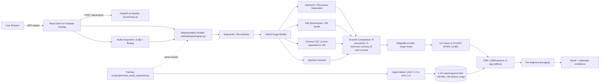
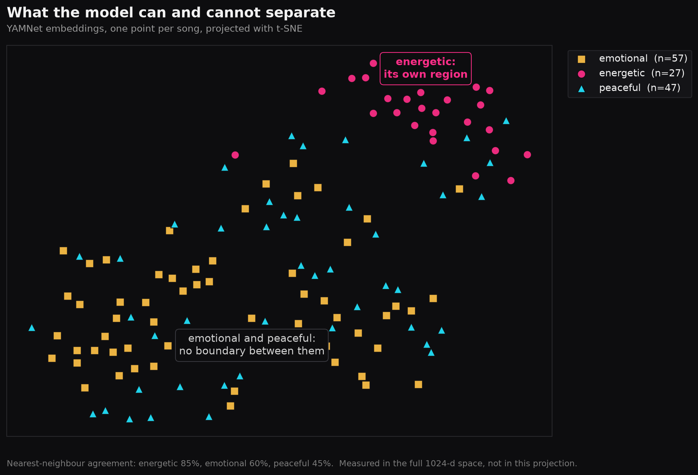

# Architecture: MelodAI Music Mood Classifier

**Author**: Kavya Aggarwal

This document details the engineering architecture of MelodAI: how audio becomes a three-channel image, how that image becomes a mood, where the training and serving paths meet, and what the reported numbers do and do not mean.

---

## 1. High-Level System Blueprint

---

## 2. Layered Software Architecture

### Presentation Layer (`app.py`)
React client built by Vite and served as static files from Firebase Hosting; FastAPI service on Render behind `/api`. The two are separate origins, so the API carries an explicit CORS allowlist.

The client accepts an MP3, WAV, FLAC or OGG upload, the formats libsndfile decodes from memory. M4A and AAC are refused up front, since they never decoded. It draws the exact three-channel image the network receives, with the per-window energy curve overlaid on the same time axis, so a preprocessing fault is visible rather than silent. The corpus map is baked into the bundle at build time by `scripts/bake_corpus.py`, so the page is complete on first paint without touching the API, which matters because a free instance sleeps after fifteen minutes.

### Representation Layer (`melodai/spectrogram.py`)
The single source of truth for turning audio into model input, imported by both the app and the training scripts. Exposes `hybrid_image`, `to_model_input`, `segments` and `predict`. This module exists because its absence was a defect: training and serving each built their own representation and silently diverged (see §4).

### Model Layer (`models/best_model.h5`)
Custom CNN, 3,053,699 parameters, input `(224, 224, 3)`, output a 3-way softmax over `[Emotional, Energetic, Peaceful]`. Trained with label smoothing, early stopping on validation accuracy, `ReduceLROnPlateau`, and `ModelCheckpoint` on best validation accuracy.

### Data Preparation Layer (`scripts/`)
`download_songs.py` fetches 90-second clips; `generate_smart_segments.py` cuts two 45-second segments per song and emits four augmented variants of each; `resizing.py` normalises every image to 224x224; `train_segmented_model.py` trains; `evaluate_song_level.py` evaluates (see §4).

---

## 3. The Representation, in Detail

The central design decision is that a CNN is given three *different* views of the same audio rather than one view copied three times. Each channel is percentile-normalised between the 2nd and 98th percentile, so a single loud frame cannot flatten the rest of the image.

| Channel | Content | What it carries |
|---|---|---|
| Red | Percussive component after HPSS | Rhythm and attack density |
| Green | `0.5 x` harmonic mel `+ 0.5 x` chroma expanded to 128 rows | Melody and key content |
| Blue | `0.6 x` mel `+ 0.4 x` spectral contrast | Overall energy and timbral texture |

Fixed parameters: `sr=22050`, `n_mels=128`, `hop_length=256`, `n_fft=2048`, `fmin=20`, `fmax=8000`, Gaussian blur `sigma=0.5` per channel.

The image is then written to PNG through matplotlib with `origin="lower"` and resized by OpenCV. That file round trip is part of the representation, not an implementation detail: it flips the image vertically and quantises it to 8 bits, and the model learned on the result. Reproducing it in memory would produce a different distribution.

---

## 4. Verification and Known Limits

### The defect this architecture is built to prevent
Training produced the three-channel image described above. The deployed app independently produced a plain mel spectrogram at `hop_length=512`, stacked it into three identical greyscale channels, and zero-padded the 128-row result into a 224x224 frame, leaving **43% of the image black** on a 45-second clip and 90% on a short one. The training script selects cross-channel features by name; all of them are identically zero when the channels are copies.

Nothing raised. The app returned a confident-looking percentage while the probability vector sat near a third each, which is what guessing looks like. `tests/test_spectrogram.py` now asserts bit-identical equality (`np.array_equal`) between this module and the training script's own function, and fails if either drifts.

### Measured, on a clean song-grouped holdout

Reproducing the original evaluation gives **66.1% per image**, matching the
reported figure exactly, and **62.1% per song**. Rebuilding the split so that
songs are grouped and contradictory labels removed, and scoring both models
on that identical 25-song holdout:

| | overall | emotional | energetic | peaceful |
|---|---|---|---|---|
| original model | 64.0% | 100% | 100% | **0%** |
| retrained (`train_v2.py`) | 64.0% | 45% | 100% | **67%** |

The same headline number describes two very different systems. The original
model never once predicts `peaceful` correctly on this holdout; it scores
64% because the other two classes account for 16 of the 25 songs. It is a
two-class classifier reported as a three-class one, and a single accuracy
figure conceals that completely.

The retrained model discriminates all three classes. It is not yet a better
classifier by the headline metric; it is an honest one.

### What is actually separable

Five architectures across two representations all reach roughly two thirds
and fail the same way. At that point the question stops being which model
and becomes what the data supports, which a projection of the representation
answers directly.

Each point is one song, its YAMNet frame embeddings averaged, projected with
t-SNE. `energetic` occupies its own region. `emotional` and `peaceful` have
no boundary between them at all.

The picture is suggestive; these numbers are not, because they are computed
in the full 1024 dimensions before any projection:

| class | nearest neighbour shares its label | chance | lift |
|---|---|---|---|
| energetic | **85.2%** | 20.6% | **4.13x** |
| emotional | 59.6% | 43.5% | 1.37x |
| peaceful | 44.7% | 35.9% | 1.25x |

Silhouette score across the three classes is **0.073**, where 1 is tight and
well separated and 0 is indistinguishable.

So `energetic` is a real region of the space and the other two are one
cloud. No classifier reading this representation can separate them, which is
why every attempt failed identically. A taxonomy sweep agrees: `party`
against everything else scores **26 of 26** on validation and 105 of 105 on
training, where always predicting the majority would score 21 of 26 and
catch none of the five.

The corpus explains it. Mainstream Bollywood occupies a narrow band of
tempo, instrumentation and production; a party track genuinely leaves that
band, while romantic, sad and calm tracks do not. Arousal is recoverable
from this audio. Valence, at 131 songs, is not.

That is a measurement, not a failure, and it is the result this project
reports.

### Transfer learning

The from-scratch network reaches 97% training accuracy against 63%
validation. That 34 point gap is not a regularisation problem to tune away:
a 4.8M parameter network is being asked to learn what edges and textures are
from 844 images. `scripts/train_transfer.py` fits a head on an
ImageNet-pretrained EfficientNetB0 instead, freezing the backbone first and
then unfreezing its top third at a 100x lower learning rate, with BatchNorm
statistics kept frozen throughout.

All three models, scored per song on the identical 25-song clean holdout:

| | overall | 95% CI | emotional | energetic | peaceful | train/val gap |
|---|---|---|---|---|---|---|
| original | 64.0% | 45-80% | 100% | 100% | **0%** | - |
| from scratch, fixed data | 64.0% | 45-80% | 45% | 100% | 67% | 98% / 64% |
| transfer + fine-tune | 60.0% | 41-77% | 45% | 100% | 56% | **54% / 62%** |

The transfer row reports **60%, measured on reload**. The training run
printed 68% for the same model on the same holdout, and the saved file does
not reproduce it: two songs differ. Either the `.h5` format is not round
tripping the nested EfficientNet faithfully, which is a known weakness in
TF 2.16 where `.keras` is the supported format, or 68% was noise on 25
songs. Until that is resolved the lower, reproducible number is the one
recorded here.

Either way the headline gain was never real. What is a result is the last
column. The transfer model's training accuracy
sits *below* its validation accuracy, because augmentation applies only to
training; it has stopped memorising. The from-scratch model's 34 point gap
was the ceiling, and it is gone.

That matters more than the headline, because overfitting was what capped
every previous attempt. The remaining errors are now a data problem - 141
songs, with `energetic` at 29 - rather than a capacity problem.

An audio-pretrained backbone (YAMNet, PANNs) should beat an ImageNet one,
which knows photographs rather than music. That needs the source MP3s rather
than the rendered spectrograms, so it is the next piece of work.

### Two data defects behind that

**Contradictory labels.** The source CSV lists 11 songs under more than one
category, and 150 rows resolve to only 137 distinct YouTube URLs. Five songs
therefore exist as byte-identical images under two class folders, verified by
SHA-256. Every one of them involves `peaceful`. The model was shown the same
image labelled two ways, and those duplicates also guarantee exact-duplicate
leakage across any split.

**Augmentation that does not correspond to audio.** The original training
applied photographic transforms to spectrograms: `rotation_range=15`,
`shear_range=0.1`, `horizontal_flip=True`, `brightness_range`, and a
`height_shift_range` commented as a time shift when height is the frequency
axis. Rotating a spectrogram makes a partial drift across frequency bands as
time passes, which is not a sound; shifting it vertically transposes the key
while keeping the label, and the green channel is chroma. `train_v2.py` uses
SpecAugment-style time and frequency masking instead, where every surviving
pixel still means what it meant. Pitch and tempo augmentation already happen
correctly, in the audio domain, at spectrogram generation time.

### What the accuracy figure means
Reported: **66% overall**, with per-class F1 of Energetic 88%, Emotional 74%, Peaceful 27%.

Two qualifications belong with that number.

**Independence.** The 236 validation images are roughly **30 distinct songs** seen eight ways each (2 segments x 4 augmentations). Quoting an interval over the image count implies a precision the data does not support:

| counted as | 95% confidence interval |
|---|---|
| 236 images | 60% to 72% |
| ~30 songs | **48% to 80%** |

One misread song moves the figure by about three points. `scripts/evaluate_song_level.py` aggregates a song's images into one prediction and reports the Wilson interval on the song count.

**Leakage.** Keras `validation_split` divides the alphabetically sorted file list, and every variant shares its song's filename prefix, so songs stay whole except where the 80% boundary cuts one. Measured: **one song, 1.7% of validation images.** Small, bounded, and reported rather than assumed.

### Honest performance characteristics
- Peaceful at 27% F1 means the model effectively discriminates two classes, not three; roughly 70% of Peaceful samples are read as Emotional.
- 136 distinct songs is a small corpus for three-class audio classification. 66% against a 33% chance baseline is genuine learning, not a strong classifier.
- Mood is not categorical. A valence/arousal regression would describe the phenomenon more honestly than three discrete labels.

---

## 5. Inference Lifecycle

1. Audio arrives by upload or `yt-dlp` download, decoded through ffmpeg.
2. `librosa.load` at 22,050 Hz, mono, full duration.
3. `segments()` splits into 45-second windows, matching the training segment length. A clip shorter than one window is used whole rather than padded, since padding would be a picture of silence.
4. Each window becomes a hybrid image, encoded and resized through the same path as training.
5. The model scores every window; probabilities are averaged.
6. The averaged distribution yields the label and confidence, with the per-window verdicts retained.

Step 5 is test-time augmentation: one extra forward pass per window, strictly better than trusting whichever window happened to be first.

---

## 6. Operational Notes

- **ffmpeg** is a system dependency, installed in the image, so librosa can fall back to audioread for formats libsndfile cannot decode.
- **YouTube ingestion is best-effort.** Downloads originating from datacenter IP ranges are frequently refused. Upload is the reliable path on any hosted deployment.
- **Serving carries no TensorFlow.** YAMNet runs from a vendored 16 MB TFLite build and the energy head is four matrix multiplies over NumPy arrays exported by `scripts/export_energy_head.py`, which refuses to write unless it reproduces Keras to 1e-5. Measured against the TensorFlow path on real tracks: identical labels, scores to 1e-8, same AudioSet ranking and neighbours.

  That took the install from 2.1 GB to 441 MB and removed the `numpy<2` / `protobuf<5` / Python-3.12 constraint knot. Peak request memory went from 713 MB to roughly 450 by running YAMNet in fixed 15-second chunks, drawing the display spectrogram at a coarse hop over a 30-second window, and calling `malloc_trim` after each request, which is what makes a 512 MB instance viable.

- **The analysis endpoint is a sync `def`, deliberately.** Declared `async`, its blocking CPU work occupies the event loop and `/api/health` cannot answer for the duration; on a host that health checks and restarts on failure, every analysis became a restart. As a sync `def` FastAPI runs it in a worker thread.

- **The training checkpoints** remain 35 MB each through Git LFS. Nothing at serving time loads them.
