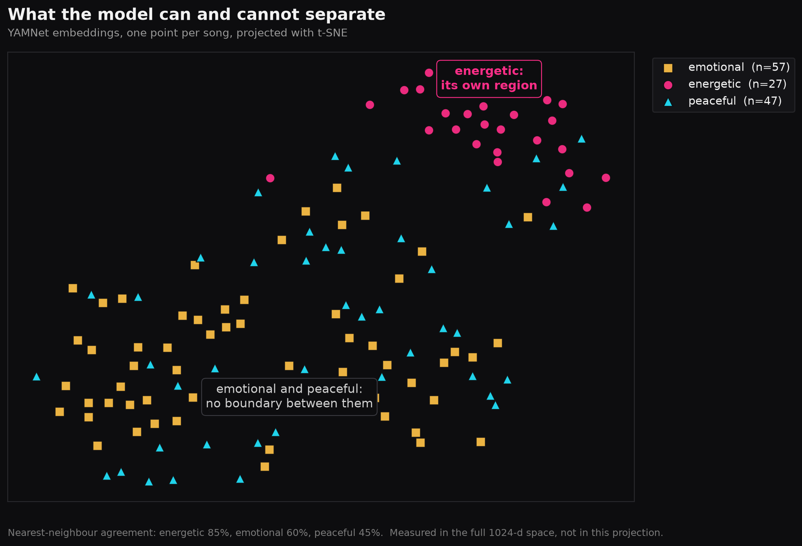

# MelodAI

**What a neural network can actually tell about a Bollywood track, and what it cannot.**

**[Live](https://melodai.web.app)** · React on Firebase Hosting, FastAPI on Render.

This began as a three-way mood classifier reporting 66% accuracy. It is now
an energy detector that reports 26 of 26, plus the measurement explaining why
the other two thirds of the original problem are not solvable with this data.

That change is the project.

---

## The finding



One point per song: YAMNet embeddings, projected. `energetic` occupies its own
region. `emotional` and `peaceful` have no boundary between them.

Measured in the full 1024 dimensions, before any projection:

| class | nearest neighbour shares its label | chance | lift |
|---|---|---|---|
| energetic | **85.2%** | 20.6% | **4.13x** |
| emotional | 59.6% | 43.5% | 1.37x |
| peaceful | 44.7% | 35.9% | 1.25x |

Silhouette score across the three: **0.073**, where 1 is well separated.

Mainstream Bollywood sits in a narrow band of tempo, instrumentation and
production. A party track leaves that band; a romantic, sad or calm one does
not. **Arousal is recoverable from this audio. Valence, at 131 songs, is not.**

Five architectures across two representations reached about two thirds and
failed identically. The ceiling was never the model.

---

## What the app does

Upload a track and it shows the working, not just a label.

- **Energy**, averaged over every 0.96 second window. The one prediction the data supports.
- **Energy through the track**, so a build or a drop is visible rather than averaged away.
- **What the network hears**: the highest-scoring AudioSet classes from YAMNet's final layer, with the ones every piece of music scores on removed. A party track reads *Dance music, Disco, House, Techno*; a ballad reads *Singing, Lullaby, Music of Asia*.
- **Closest songs in the corpus**, by cosine similarity in the embedding space. Not a genre lookup; this is what "sounds alike" means to the model.
- **Where it lands** on the corpus map, projected with UMAP rather than t-SNE because t-SNE cannot place a point it was not fitted on.
- **The project's own spectrogram encoding**: red percussive, green harmonic plus chroma, blue mel plus spectral contrast.

---

## How it got here

| step | result |
|---|---|
| Original CNN, as reported | 66% over three classes |
| Same model, clean song-grouped holdout | 64%, with `peaceful` at **0 of 9** |
| Retrained on fixed data and augmentation | 64%, all three classes working |
| EfficientNet transfer | 60% on reload, overfitting gap closed |
| YAMNet embeddings | 68%, `peaceful` still 1 of 9 |
| Energy only | **26 of 26** |

Three defects were found along the way, each by checking rather than assuming:

**Training and serving built different spectrograms.** The app produced a plain
mel at a different hop length, stacked into three identical greyscale channels
and zero-padded into a 224x224 frame, leaving 43% of the image black. Nothing
raised; the probabilities simply sat near a third each.

**The augmentation was photographic.** `rotation_range`, `shear_range`,
`horizontal_flip` and a vertical shift commented as a time shift, applied to a
spectrogram whose vertical axis is frequency and whose green channel is chroma.

**Five songs carried contradictory labels.** The source CSV lists 11 songs under
more than one category; 150 rows resolve to 137 URLs. Identical audio was filed
under two moods, verified by hash.

Full detail in [ARCHITECTURE.md](ARCHITECTURE.md).

---

## Running it

```bash
python -m venv .venv && source .venv/bin/activate
pip install -r requirements.txt
# API (serves the built client too, if web/dist exists)
pip install -r server/requirements.txt
uvicorn server.main:app --port 8711

# Client, in a second shell: proxies /api to the above
cd web && npm install && npm run dev
```

The pins in `requirements.txt` are deliberate: TensorFlow 2.16 needs
`numpy<2` and `protobuf<5`, Streamlit from 1.40 needed `protobuf>=5.26`, and
umap-learn 0.6 needs `numpy>=2`. Loosening any one of them installs cleanly
and fails at import.

To rebuild from audio:

```bash
python scripts/generate_smart_segments.py     # spectrograms, if using the CNN path
python scripts/yamnet_embeddings.py           # embeddings, cached
python scripts/build_app_assets.py            # energy model, corpus, projector
python scripts/evaluate_song_level.py         # honest per-song evaluation
python scripts/experiment_taxonomy.py         # the grouping sweep
pytest tests/                                 # 39 tests
(cd web && npm test)                          # 5 tests
```

---

## Known limits

- 131 songs after removing contradictory labels. Every figure here carries a
  wide interval, and they are reported with the numbers rather than hidden.
- The corpus is mainstream Hindi film music. Nothing here is claimed to
  generalise beyond it.
- YouTube ingestion is best-effort: downloads from datacenter IPs are
  frequently refused, so upload is the reliable path on any hosted deployment.
- Valence remains unsolved, and solving it needs more data and probably labels
  that are not one category per song.
